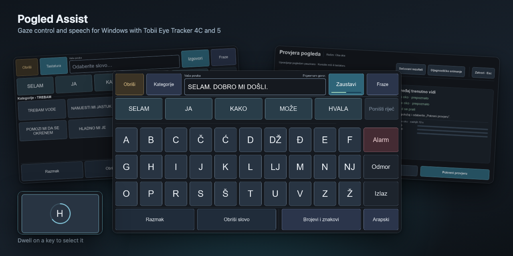

# Pogled Assist

Windows desktop controls for Tobii Eye Tracker 4C and Eye Tracker 5. The app turns gaze into pointer movement, dwell clicks, a Bosnian speech keyboard, an on-screen keyboard, and a Quick actions grid for clicks, scrolling and Enter. Connect one tracker at a time; [tracker setup and replacement](docs/USER_GUIDE.md#before-starting) describe the matching Tobii software and reconnection limits.



The image uses synthetic preview data from the [rendered UI gallery](docs/UI_DEVELOPMENT.md#rendered-ui-gallery).

[Download a Windows release](https://github.com/Hasan-Smajlovic/Pogled-Assist/releases)

## Features

- A top hotbar that reserves desktop space through the Windows AppBar API.
- Direct desktop pointer movement and clicks require both eyes; application controls follow the selected [eye-tracking policy](docs/USER_GUIDE.md#eye-tracking-policy).
- Left, right, and double-click modes with an optional precision zoom step.
- A Quick actions grid of eight large targets for clicking, scrolling, Enter, or typing at the current gaze target.
- A visible gaze bubble and action progress overlay.
- A full-screen Bosnian speech keyboard with offline word completion and next-word suggestions, reusable phrases, and local personal learning.
- A right-side Keyboard panel for typing into other applications, with an always-visible Enter button.
- Gaze-selectable settings for timing, smoothing, speech, startup, and logging.
- Adjustable [edge selection stability](docs/USER_GUIDE.md#selection-stability-near-edges) for Speech, Keyboard and the hotbar.
- An optional caregiver gaze check with live positioning, per-eye tracking with interruption counts, timed targets, a word written by gaze, and [saved results and ZIP export](docs/features/gaze-check.md#saved-gaze-check-results).
- Short, explicitly started [diagnostic recordings and local support ZIPs](docs/USER_GUIDE.md#diagnostic-log-collection), with a visible recording indicator.
- Tobii Pro SDK, Stream Engine, and optional 32-bit Stream Engine bridge support.

## Install

Both installation methods use `C:\PogledAssist`; later versions are installed from verified stable GitHub Releases by the packaged `update_windows.ps1`. The previous application under `C:\TobiiExec` remains a separate installation: Pogled Assist setup, installer and updater never change its files, desktop shortcut, startup task, settings, or logs.

### Windows release

Download the versioned ZIP and matching `.sha256` file from [GitHub Releases](https://github.com/Hasan-Smajlovic/Pogled-Assist/releases). Verify the checksum, extract the ZIP, then run:

```powershell
Set-ExecutionPolicy -Scope Process Bypass -Force
.\install_windows.ps1 -Launch
```

The installer verifies that the packaged executable starts and creates a desktop shortcut. The release includes Python and the application dependencies, eSpeak NG with the Bosnian voice, and standalone Edge speech tools. Standardni and Prirodni are installed with the app; no separate Python or speech-tool installation is needed. Prirodni needs internet access when speaking.

The optional Efendija voice uses an ElevenLabs account, API key and accessible voice; see [ElevenLabs setup](docs/features/elevenlabs.md).

The optional 32-bit Tobii bridge runtime is also bundled. A setup summary checks local components and device presence, with actions for official Tobii downloads and calibration. Tobii device software and personal calibration remain separate.

See the [Windows release guide](docs/WINDOWS_RELEASE.md) for checksum verification, external components, rollback, and clean-machine checks.

### Source installation

The source setup installs Python 3.10 when needed, eSpeak NG, the optional 32-bit Python bridge, a local `.venv`, launchers, and the desktop shortcut:

```powershell
Set-ExecutionPolicy -Scope Process Bypass -Force
.\setup_windows.ps1
```

Add `-Launch` to start the app after setup or `-NoPause` when running from an existing terminal.

## Run

Installed release or source setup:

```powershell
.\start_gaze_mouse.ps1
```

## Local development

The repository uses one PowerShell entry point for setup, running and verification:

```powershell
.\dev.ps1 setup
.\dev.ps1 run
.\dev.ps1 check -Parallel
```

`run` starts the real application with Tobii discovery and Windows input. Without a tracker, `.\dev.ps1 simulate` uses the mouse as gaze and can still click in Windows ([controls and limits](docs/UI_DEVELOPMENT.md#mouse-gaze-simulation)), and `.\dev.ps1 ui -Open` renders the screens without a tracker or speech engine. [Development](docs/DEVELOPMENT.md) lists every command.

## Documentation

| Need | Guide |
| --- | --- |
| Use and troubleshoot the application | [User guide](docs/USER_GUIDE.md) |
| Run the caregiver gaze check and read saved results | [Gaze check](docs/features/gaze-check.md) |
| Configure Efendija, credits and saved audio | [ElevenLabs](docs/features/elevenlabs.md) |
| Understand the runtime and compatibility baseline | [Architecture](docs/ARCHITECTURE.md) |
| Understand Bosnian word completion, prediction, and its verification | [Speech suggestions](docs/features/speech-suggestions.md) |
| Find instructions for coding agents and files that change together | [Agent guide](AGENTS.md) |
| Set up development and run checks | [Development guide](docs/DEVELOPMENT.md) |
| Write tests and find reusable fakes | [Testing](docs/TESTING.md) |
| Understand recordings or analyze a support ZIP | [Diagnostics](docs/DIAGNOSTICS.md) |
| Change UI, review screenshots, or run manual Windows/Tobii checks | [UI development and review](docs/UI_DEVELOPMENT.md) |
| See the HTML design of each screen (development only; the app does not load or package it) | [Application UI reference](docs/design/speech-keyboard-reference.html) |
| Configure or recover gallery publication | [UI gallery publication](docs/UI_GALLERY.md) |
| Troubleshoot local development checks | [Development troubleshooting](docs/DEVELOPMENT_TROUBLESHOOTING.md) |
| Prepare issues and pull requests, or check CI, review, merge and release rules | [Contributing](CONTRIBUTING.md) |
| Build, install, validate, or roll back a release | [Windows release guide](docs/WINDOWS_RELEASE.md) |

## Runtime requirements

| Component | Why it is needed |
| --- | --- |
| Tobii runtime and calibration | Device discovery and calibrated gaze data |
| `tobii-research` | Legacy preferred tracker API, included in Python and release installs; Eye Tracker 5 uses Stream Engine |
| Tobii Stream Engine | Eye Tracker 5 gaze and fallback for older consumer trackers such as Eye Tracker 4C |
| Python 3.10 x86 | Bundled bridge runtime when only a 32-bit Stream Engine DLL is available |
| eSpeak NG with `bs` voice | Default offline Bosnian speech, bundled in releases |
| `edge-playback` and `edge-tts` | Online Bosnian neural voice, bundled in releases |
| ElevenLabs account and accessible voice | Optional Efendija synthesis; see [setup](docs/features/elevenlabs.md) |

The app searches common install locations. These environment variables override discovery when needed:

| Variable | Value |
| --- | --- |
| `TOBII_STREAM_ENGINE_DLL` | Full path to `tobii_stream_engine.dll` |
| `TOBII_STREAM_ENGINE_DEVICE_CREATE_ARGS` | `3` or `4` for a Stream Engine DLL whose version cannot be recognized; see the [native SDK contract](docs/ARCHITECTURE.md#native-stream-engine-compatibility) |
| `POGLED_ASSIST_X86_PYTHON` | Full path to 32-bit Python 3.10; the older app's `TOBII_GAZE_MOUSE_X86_PYTHON` is checked as a fallback when it points to a valid 32-bit Python 3.10 |
| `TOBII_CALIBRATION_COMMAND` | Custom Tobii calibration command |
| `ESPEAK_NG_EXE` | Full path to `espeak-ng.exe` |
| `EDGE_PLAYBACK_EXE` | Full path to `edge-playback.exe` |
| `ELEVENLABS_API_KEY` | Development override for the saved credential |
| `ELEVENLABS_VOICE_ID` | Development override for the selected saved voice |
| `ELEVENLABS_MODEL_ID` | Development override for the selected model |

See [ElevenLabs setup](docs/features/elevenlabs.md) for local settings and permissions.

## Data and logs

Settings, the speech library, personal learning, logs, gaze-check results and diagnostic recordings stay in the installation's `data` and `logs` folders, outside the packaged binaries, so upgrades and rollbacks preserve them. [Persistent storage](docs/ARCHITECTURE.md#persistent-data-and-logs) lists every file, including credentials and saved audio outside `data/`.

## Current limitations

Windows x64 is the supported application platform. The executable is not code-signed, multi-monitor mapping assumes the calibrated display is primary, and Tobii hardware still requires manual validation. The complete list is in the [Windows release guide](docs/WINDOWS_RELEASE.md#known-limits).
